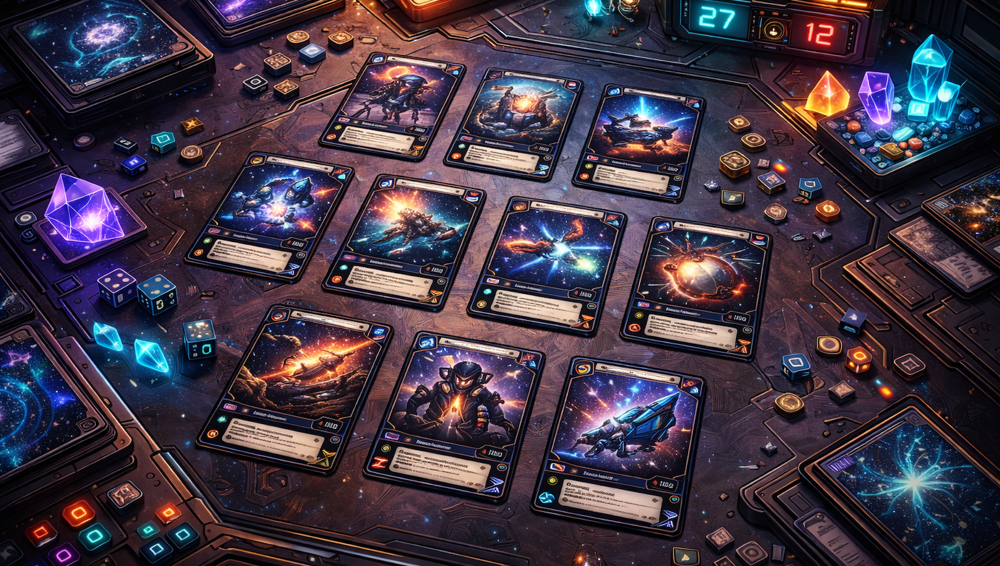

<h1 align="center">Card Forge Studio</h1>

<h3 align="center">Your ideas. A whole deck of possibilities.</h3>

## ✨ What is Card Forge Studio?

A free desktop editor suite for building card games: turn CSV data, Lua layouts, and artwork into complete decks, with live previews and flexible exports.

Create, refine, and share card games in a **live coding environment** built around your data and your imagination. Your project stays in ordinary files you control. Write a layout once, feed it your card data, and watch your deck take shape—with live previews as you work.

<strong>Beta · Windows available now · macOS and Linux planned</strong>

  <a href="https://github.com/CentauriSoldier/Card-Forge-Studio/releases"><strong>Download releases</strong></a> &nbsp; · &nbsp;
  <a href="https://cardforge.studio">Website</a> &nbsp; · &nbsp;
  <a href="https://github.com/CentauriSoldier/Card-Forge-Studio/issues">Feedback &amp; feature requests</a>

<table>
  <tr><td>
    <h3>🔒 Your content. Your control.</h3>
    
<strong>No subscription fees. No proprietary scripting language. No hosted service required to create your cards.</strong> Free, open source, and built around Lua and files you own.

    
<strong>A complete, free editor suite for your card game.</strong> Scripts, layouts, CSV data, styles, previews, and exports together.

    
Your projects stay on your computer. Editing, processing, and exporting happen locally; you decide what to share. <strong>It’s your content.</strong>

  </td></tr>
</table>

## 🃏 Build the deck you imagined

<table>
  <tr>
    <td width="50%" valign="top"><h3>⚡ Lightning-fast rendering and exports</h3>
Keep your ideas moving with live previews and fast bulk card generation, from your next layout tweak to the finished deck.
</td>
    <td width="50%" valign="top"><h3>🎨 One layout, an entire card set</h3>
Combine CSV data, Lua drawing scripts, artwork, and reusable text styles. Add processing rules to calculate card values and keep your data consistent.
</td>
  </tr>
  <tr>
    <td width="50%" valign="top"><h3>🔄 Your files are the workflow</h3>
Data, drawing scripts, processing rules, configuration, styles, and artwork remain editable project files. Save changes in Studio’s editors—or your own tools—and its file watchers pick up supported changes, update the working environment, reprocess affected data, and refresh the preview. No rebuilding the whole project just to see your next idea.
</td>
    <td width="50%" valign="top"><h3>💡 Code with context</h3>
Dynamic autocomplete knows your game helpers, configuration, and card columns. Inline documentation and a searchable Environment Reference keep the right information close.
</td>
  </tr>
  <tr>
    <td width="50%" valign="top"><h3>📦 Export for the next step</h3>
Create PNG artwork, Generic or LÖVE 11.5 atlases, finalized CSV/JSON/Lua data, themed interactive HTML galleries, or a ZIP combining your chosen outputs.
</td>
    <td width="50%" valign="top"><h3>🤝 Share editable projects</h3>
Export and import complete games or standalone card sets with their assets, version checks, validation, and missing-file repairs.
</td>
  </tr>
  <tr><td colspan="2"><h3>📚 Learn inside the app</h3>
Basic and advanced tutorials walk through the workflow; API documentation is there when you want the details.
</td></tr>
</table>

Customize editor colors and fonts, build reusable styles, and keep your project settings with the game or card set they belong to.

## 🚀 Start creating

Windows is the current release platform; **macOS and Linux support are planned**. Download a Windows release, extract the ZIP, and launch **Card Forge Studio.exe**. Open **Help → Tutorials**, then create a game and its first card set.

Card layouts and processing use **Lua**. You bring the design; the editors, previews, and reference tools help you build it.

## 💬 Help shape the beta

Found a bug or have an idea? [Open an issue](https://github.com/CentauriSoldier/Card-Forge-Studio/issues), or use **Help → Feedback** inside the app. See the [changelog](Changelog.md) for recent work.

Print/PDF, additional engine packages, and tabletop-platform exporters remain planned.

[Support the project on Patreon](https://www.patreon.com/CentauriSoldier)

## 📜 License

Card Forge Studio uses [The Unlicense](LICENSE) wherever applicable. Third-party components retain their own licenses.
